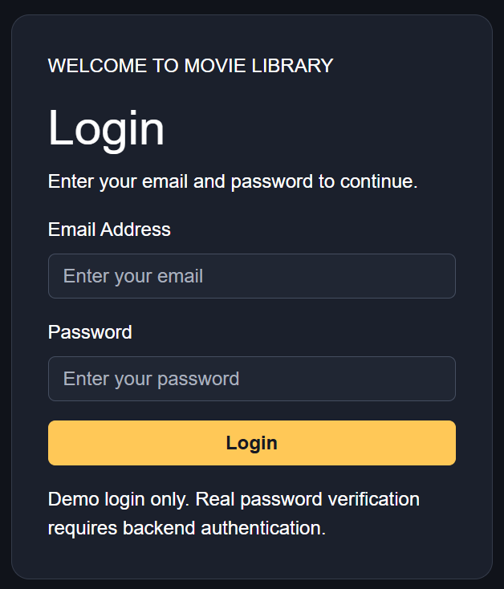
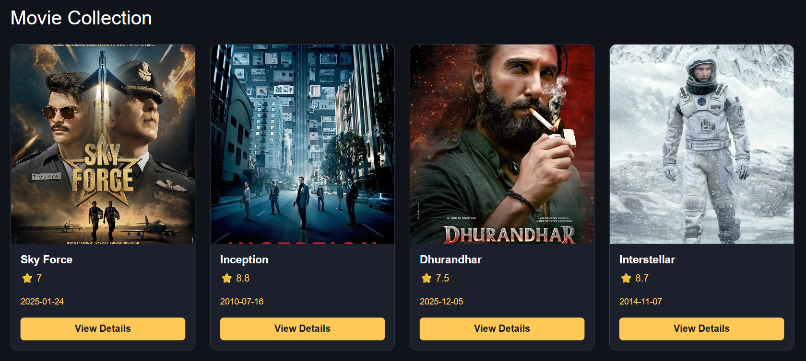
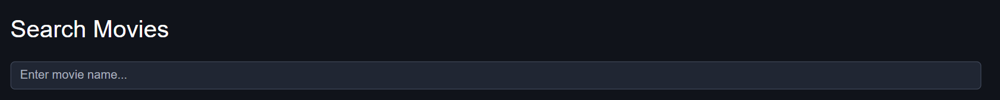
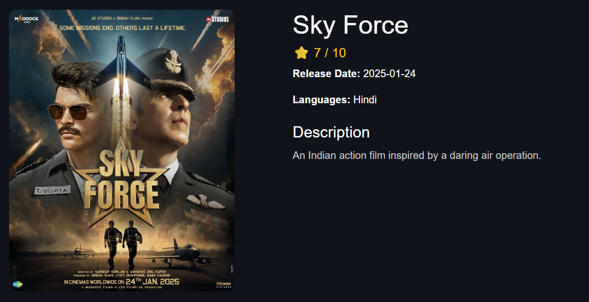
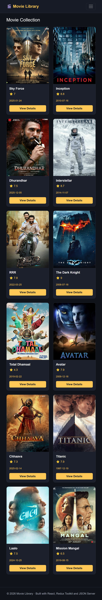

# 🎬 Movie Library App

A responsive movie library web application built with **React and Vite**. Users can sign in to the demo interface, browse the movie collection, search for movies, view movie details, and maintain a personal watchlist.


---

## 📸 Website Screenshot

> The screenshot below is the current project screenshot. If it shows an API error, start JSON Server and capture a fresh screenshot after the movie list loads.

To add more screenshots, save them inside the `screenshots/` folder and link them here, for example:

## 📸 Screenshots

### 🔑 Login Page


### 🏠 Home Page


### 🔍 Search Results


### 🎥 Movie Details Page


### 📱 Mobile View



---

## ✨ Features

- **Movie collection:** Loads movie records from `db.json` through JSON Server.
- **Movie search:** Search for movies by title.
- **Movie details:** View a movie's poster, title, language, description, rating, and release date.
- **Watchlist:** Add movies to or remove movies from a personal watchlist.
- **Local storage:** Keeps the demo login state and watchlist in the browser after refresh.
- **Routing:** Uses React Router to navigate between the app's pages.
- **Protected page:** The watchlist page is available through the app's login flow.
- **Responsive UI:** Uses CSS and Bootstrap styling for different screen sizes.
- **Loading and error states:** Shows feedback while movies are loading or if the API is unavailable.

## 🧰 Tech Stack

| Technology | Purpose |
|---|---|
| React | Builds the user interface using components |
| Vite | Development server and build tool |
| Redux Toolkit | Manages movie and authentication state |
| React Redux | Connects React components to the Redux store |
| Axios | Sends HTTP requests to the movie API |
| React Router DOM | Handles page navigation |
| Bootstrap | Provides responsive UI utilities |
| CSS | Custom layout and visual styling |
| JSON Server | Serves movie data from `db.json` as a local REST API |
| localStorage | Saves demo login state and watchlist in the browser |

## 📁 Project Structure

```text
movie-app/
├── screenshots/
│   └── movie-library-home.png
├── src/
│   ├── components/
│   │   ├── Navbar.jsx
│   │   ├── MovieList.jsx
│   │   ├── MovieCard.jsx
│   │   ├── MovieSearch.jsx
│   │   ├── MovieDetail.jsx
│   │   └── PrivateRoute.jsx
│   ├── redux/
│   │   ├── store.js
│   │   ├── movieSlice.js
│   │   └── authSlice.js
│   ├── App.jsx
│   ├── main.jsx
│   └── index.css
├── db.json
├── index.html
├── package.json
└── README.md
```

*This structure describes the project files used for this app. If your local filenames differ, update this tree to match your folder.*

## 🚀 Getting Started

### Prerequisites

- [Node.js](https://nodejs.org/) installed
- npm (included with Node.js)

### 1. Open the project folder

Open the project in VS Code and open a terminal in the folder that contains `package.json`.

### 2. Install dependencies

```bash
npm install
```

### 3. Start JSON Server

Open **Terminal 1** and run:

```bash
npm run server
```

The local movie API should be available at:

**http://localhost:3000/movies**

If the command is missing, confirm that the `server` script and `json-server` dependency are present in your `package.json`.

### 4. Start the React app

Open **Terminal 2** in the same project folder and run:

```bash
npm run dev
```

Open the local URL printed by Vite, usually **http://localhost:5173**.

> **Important:** Keep both terminals running. If JSON Server is stopped, the app may show a movie-loading or API error.

## 📜 Common Commands

| Command | Purpose |
|---|---|
| `npm install` | Installs project dependencies |
| `npm run server` | Starts JSON Server on port 3000 |
| `npm run dev` | Starts the Vite development server |
| `npm run build` | Builds the app for production, if configured in `package.json` |
| `npm run preview` | Previews a production build, if configured in `package.json` |

## 🔌 API and Movie Data

The movie records are stored in `db.json` and served by JSON Server.

- **Get all movies:** `GET http://localhost:3000/movies`
- **Get one movie:** `GET http://localhost:3000/movies/1` (replace `1` with a movie ID)

Example movie object matching this project's movie data format:

```json
{
  "id": "17",
  "title": "Chhaava",
  "poster": "https://placehold.co/500x750/252b37/ffffff?text=Chhaava",
  "languages": ["Hindi"],
  "description": "A historical action drama about Chhatrapati Sambhaji Maharaj.",
  "rating": 7.3,
  "releaseDate": "2025-02-14"
}
```

Add new movie objects inside the `movies` array in `db.json`. Make sure every movie has a unique ID and valid JSON commas/brackets.

## ❤️ Watchlist and Login Notes

- The watchlist is saved in browser `localStorage` using the key `movie-watchlist`.
- The demo login state uses `localStorage` and is intended for learning and demonstration.
- This is not production-grade authentication. Do not use it to protect sensitive information.

## 🖼️ How to Capture a Fresh Full-Page Screenshot

1. Start JSON Server and the React app.
2. Open the website in Chrome and wait until the movie cards appear.
3. Press `F12` to open Developer Tools.
4. Press `Ctrl + Shift + P` (Windows) to open the command menu.
5. Type **Capture full size screenshot** and select it.
6. Save the screenshot in the project's `screenshots` folder.
7. Replace the image filename in the **Website Screenshot** section above if needed.

## 🛠️ Troubleshooting

**Movies are not loading**

- Confirm JSON Server is running in Terminal 1.
- Visit `http://localhost:3000/movies` in your browser. JSON data should appear.
- Confirm `db.json` contains a top-level `movies` array.
- Check the browser console and terminal for errors.

**Poster image is missing**

- Check that the image URL opens in a browser.
- Use a direct image URL and keep the `poster` field name consistent with the app.

**Port 3000 is already in use**

- Stop the other process using port 3000, or update the JSON Server command and API URL together.

## 🔮 Future Improvements

- Add movie filters for language, rating, and release date.
- Improve authentication with a secure backend.
- Add pagination and sorting.
- Add a dedicated watchlist counter and empty-state design.
- Deploy the frontend and API for public access.

## 👨‍💻 Author

**Movie Library App** — built as a React learning project.

---

*Made with React, Redux Toolkit, and JSON Server.*
